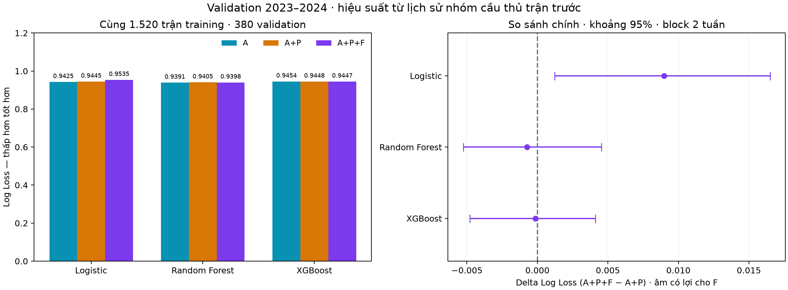

# A+P+F: đóng góp bổ sung của hiệu suất cầu thủ

**Kết luận development:** tám biến performance F chưa cho thấy lợi ích rõ ràng. So với A+P, Random Forest và XGBoost giảm Log Loss rất ít; Logistic Regression tăng Log Loss. Kết quả không chứng minh mọi dữ liệu cầu thủ đều không hữu ích, và chưa trả lời giả thuyết starting XI chính thức.

## Thiết kế đã đăng ký

- 40 cột A + 12 cột P + 8 cột F = 60 đặc trưng. F gồm rate bàn thắng/kiến tạo đã giảm nhiễu, mức tập trung đóng góp và phần đóng góp của nhóm người tham gia trận trước.
- Rate là tổng có trọng số 90×G/(M+180) hoặc 90×A/(M+180), với trọng số là tỷ trọng phút ở trận trước gần nhất. M/G/A lấy tối đa năm trận trước của chính đội, cùng mùa. Prior 180 phút về rate 0 cố định trước khi đo.
- Cả ba nhánh có cùng 1.520 trận training 2019–2023, cùng 380 trận validation 2023–2024. A và A+P được giữ nguyên từ AP_dev_v1, kiểm tra cohort/nhãn/xác suất/metric và checksum; không chọn lại đối chứng.
- So sánh chính A+P+F trừ A+P; so sánh với A_common là phụ. Cùng ba fold theo thời gian, bốn ứng viên mỗi thuật toán; 36 fit CV mới và ba estimator cuối.
- Chọn tham số bằng Log Loss training CV; fit imputer/scaler riêng từng fold. Không class weighting, không chỉnh threshold, chưa calibration.
- Cấu hình và mã đã commit trước fit; validation A/P đã được quan sát. Đây là development tuần tự có giới hạn, không phải một đánh giá hoàn toàn chưa từng quan sát validation.
- CPU local, cây n_jobs=2. Runner đo 14.77 giây, gồm fit/diagnostics, không gồm dựng feature/báo cáo. Log lưu tại progress.log.
- Chưa tạo F cho test và chưa tính metric test. Availability là giả định nửa đêm địa phương kế tiếp, chưa chứng minh thời điểm xuất bản của nguồn trong quá khứ.

## Kết quả validation

| Thuật toán | Nhánh | Accuracy | Macro F1 | Log Loss ↓ | Brier ↓ |
|---|---|---:|---:|---:|---:|
| Logistic Regression | A_common | 56.32% | 0.41426 | 0.94246 | 0.55461 |
| Logistic Regression | A_plus_P | 57.11% | 0.42639 | 0.94449 | 0.55581 |
| Logistic Regression | A_plus_P_plus_F | 56.84% | 0.42464 | 0.95347 | 0.56107 |
| Random Forest | A_common | 56.05% | 0.41349 | 0.93906 | 0.55380 |
| Random Forest | A_plus_P | 56.05% | 0.41404 | 0.94054 | 0.55469 |
| Random Forest | A_plus_P_plus_F | 56.32% | 0.41564 | 0.93980 | 0.55443 |
| XGBoost | A_common | 56.58% | 0.41645 | 0.94541 | 0.55740 |
| XGBoost | A_plus_P | 58.16% | 0.42810 | 0.94483 | 0.55679 |
| XGBoost | A_plus_P_plus_F | 56.05% | 0.41242 | 0.94468 | 0.55654 |
| Elo common | baseline | 57.37% | 0.42271 | 0.93133 | 0.54896 |
| Tần suất common | baseline | 46.05% | 0.21021 | 1.05440 | 0.63749 |

Brier dùng tổng bình phương sai số ba lớp rồi lấy trung bình, miền [0,2]. Thứ tự xác suất H,D,A; nhãn argmax. Elo common vẫn có Log Loss tốt nhất trong bảng.



## Tham số và độ bất định

| Thuật toán | Tham số thay đổi được chọn | Log Loss CV trung bình | SD giữa ba mùa |
|---|---|---:|---:|
| Logistic Regression | {"C": 0.01} | 1.025462 | 0.050011 |
| Random Forest | {"max_depth": 4, "min_samples_leaf": 30} | 1.010619 | 0.058594 |
| XGBoost | {"max_depth": 2, "n_estimators": 100} | 1.020048 | 0.066502 |

Điểm CV đã dùng chọn tham số không phải điểm kiểm tra độc lập. Cả ba cấu hình được chọn trùng với lựa chọn A+P theo từng thuật toán trong lượt trước.

Delta = Log Loss A+P+F trừ nhánh tham chiếu, âm có lợi cho mô hình mới. Paired moving-block bootstrap 2.000 lần, seed 42, block chính hai tuần và phân tích độ nhạy một/bốn tuần.

| Thuật toán | Tham chiếu | Block tuần | Delta | Khoảng percentile 95% |
|---|---|---:|---:|---|
| Logistic Regression | A_common | 1 | 0.011009 | [-0.002190; 0.025228] |
| Logistic Regression | A_common | 2 | 0.011009 | [-0.003585; 0.023474] |
| Logistic Regression | A_common | 4 | 0.011009 | [-0.005511; 0.021192] |
| Logistic Regression | A_plus_P | 1 | 0.008985 | [0.001759; 0.016418] |
| Logistic Regression | A_plus_P | 2 | 0.008985 | [0.001230; 0.016507] |
| Logistic Regression | A_plus_P | 4 | 0.008985 | [-0.000434; 0.017196] |
| Random Forest | A_common | 1 | 0.000733 | [-0.004127; 0.005754] |
| Random Forest | A_common | 2 | 0.000733 | [-0.004831; 0.006614] |
| Random Forest | A_common | 4 | 0.000733 | [-0.005218; 0.007687] |
| Random Forest | A_plus_P | 1 | -0.000744 | [-0.005523; 0.003800] |
| Random Forest | A_plus_P | 2 | -0.000744 | [-0.005256; 0.004544] |
| Random Forest | A_plus_P | 4 | -0.000744 | [-0.005093; 0.003978] |
| XGBoost | A_common | 1 | -0.000725 | [-0.005530; 0.004164] |
| XGBoost | A_common | 2 | -0.000725 | [-0.005939; 0.003751] |
| XGBoost | A_common | 4 | -0.000725 | [-0.006134; 0.003776] |
| XGBoost | A_plus_P | 1 | -0.000146 | [-0.004398; 0.004004] |
| XGBoost | A_plus_P | 2 | -0.000146 | [-0.004798; 0.004107] |
| XGBoost | A_plus_P | 4 | -0.000146 | [-0.004601; 0.003926] |

So với A+P, RF/XGBoost có mọi khoảng chứa 0. Logistic kém hơn trên ước lượng điểm và khoảng chính hai tuần nằm hoàn toàn trên 0, nhưng khoảng bốn tuần chứa 0; mức chắc chắn nhạy với cách resample. Không tuyên bố cải thiện hoặc suy giảm vững chắc trên mọi mùa. Các khoảng chưa điều chỉnh nhiều so sánh, chỉ resample một mùa với mô hình cố định, không bao gồm toàn bộ bất định huấn luyện.

## Lớp hòa và vai trò F

Logistic A+P+F chọn hòa bảy lần và đúng một trong 82 trận hòa: precision D≈14,29%, recall D≈1,22%. RF/XGBoost mới không chọn D. Chất lượng phân loại hòa vẫn yếu; probability scoring vẫn tính đầy đủ xác suất D. Precision/recall/F1 từng lớp và confusion matrices có trong results.json; reliability bins có trong CSV.

| Thuật toán mới | Tăng Log Loss khi hoán vị F | SD 10 lần |
|---|---:|---:|
| Logistic Regression | -0.004217 | 0.005965 |
| Random Forest | 0.002565 | 0.002379 |
| XGBoost | 0.000649 | 0.002789 |

Hoán vị chung tám cột F trong cùng tháng validation; không fit lại. Kết quả phụ thuộc mô hình và tương quan với A/P; SD chỉ là biến thiên phép hoán vị. Không dùng importance làm quan hệ nhân quả hoặc lý do chọn lại feature sau khi xem điểm.

## Giới hạn và quyết định

- Nhóm người tham gia trận trước có thể khác nhân sự hiện tại, nhất là chuyển CLB, chấn thương hoặc xoay tua. Chưa có bằng chứng announced XI T−60, không gắn kết quả này với Model C theo XI chính thức.
- Assists là định nghĩa FPL. Rate với prior 0 là proxy được regularize; chưa phải ước lượng đội sẽ ghi bao nhiêu bàn. Tín hiệu F có thể trùng với bàn thắng/phong độ cấp đội.
- Reset player ID đầu mùa, giữ missing khi thiếu lịch sử; không lọc bỏ trận khó. Không sử dụng xG/xA, tuổi hoặc market value vì chưa đủ lịch sử đáng tin cậy.
- Kết thúc mở rộng feature thăm dò sau phiên bản đã đăng ký này. Giữ cả kết quả P/F không cải thiện trong báo cáo; không đổi cửa sổ hay shrinkage để tìm điểm validation đẹp hơn.
- Bước tiếp theo: tổng hợp các mô hình/nhóm đặc trưng đã thử, chốt phương pháp calibration và danh sách đánh giá trước vòng test cuối. Nếu calibrator fit trên 2023–2024, điểm trên chính mùa này chỉ là chẩn đoán in-sample.

## Kiểm chứng và chạy lại

73 unit tests đã đạt. F có năm kiểm tra trên dữ liệu thật: prefix invariance, tương lai không đổi training, trận hiện tại không đổi chính nó, đảo thứ tự đầu vào và lineage không vượt cutoff. Kiểm chứng artifact xác nhận đối chứng cũ không đổi, cùng cohort, đủ 36 điểm CV, nạp lại bundle/estimator/native XGBoost khớp xác suất và toàn bộ metric/confusion matrices.

```powershell
python scripts/build_player_performance.py
python -m unittest discover -s tests -q
python -u scripts/train_APF.py
python scripts/report_APF.py
```

Runner từ chối ghi đè run tồn tại. Report có thể dựng lại độc lập từ mô hình cục bộ tin cậy, không huấn luyện lại.
