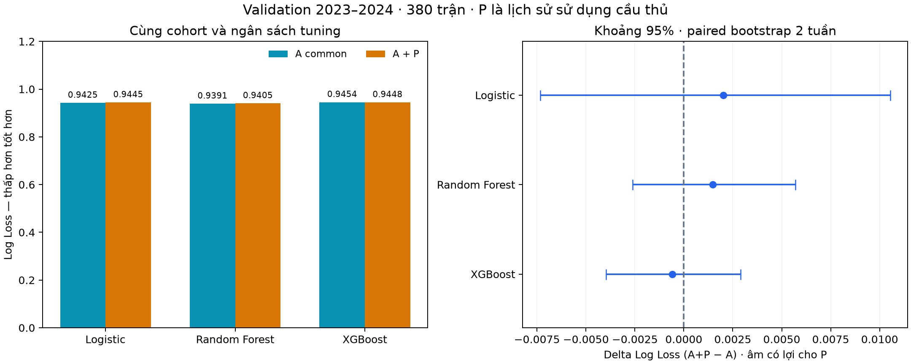

# A_common so với A+P: kết quả development

**Kết luận:** bộ 12 đặc trưng lịch sử sử dụng cầu thủ chưa cải thiện Log Loss một cách rõ ràng trên validation. XGBoost tăng Accuracy nhưng lợi ích Log Loss rất nhỏ và khoảng bất định chứa 0. Đây là kết quả thực nghiệm hợp lệ; không suy ra mọi dữ liệu cầu thủ đều vô ích.

## Thiết kế so sánh

- Run AP_dev_v1; cả hai nhánh được fit lại trên cùng 1.520 trận 2019–2020 đến 2022–2023, đánh giá cùng 380 trận 2023–2024. Không so trực tiếp với A_full train 3.040 trận để quy hiệu quả cho P.
- A_common dùng 40 đặc trưng A; A+P giữ nguyên 40 cột đó và thêm 12 cột P. Lịch sử cấp đội trước 2019 được giữ giống nhau; lịch sử cầu thủ reset đầu mùa do ID có season scope.
- P chỉ mô tả mức sử dụng/continuity từ tối đa năm trận trước của đội: số người tham gia, HHI phút, tỷ trọng phút của top 11 và mức lặp lại người/phút giữa trận. Không dùng performance ghi bàn/kiến tạo, current XI, injury hoặc market value trong P phiên bản này.
- Ba fold theo mùa 2020–2021, 2021–2022, 2022–2023, có lần lượt 380/760/1.140 trận training. Mỗi thuật toán/nhánh chọn trong bốn cấu hình giống nhau; preprocessing fit riêng trên phần training.
- Tổng 72 lượt fit CV, sáu estimator chính cuối và một Elo baseline common. Baseline tần suất được tính lại trên training common. Không class weighting, không chỉnh threshold, không calibration.
- Cấu hình và code đã được commit trước lượt fit. Đã xem validation A_full trong các bước trước; đây là development tuần tự, không phải một nghiên cứu hoàn toàn chưa quan sát validation.
- CPU local, n_jobs=2 cho cây; runner đo 27.98 giây gồm fit và diagnostics, không gồm tạo feature/báo cáo. Log đầy đủ được lưu ở progress.log.
- Chưa tạo feature P cho test, chưa tính metric test 2024–2025. Shared outcomes chỉ được lọc để lấy ID development.

## Kết quả validation

| Thuật toán | Nhánh | Accuracy | Macro F1 | Log Loss ↓ | Brier ↓ |
|---|---|---:|---:|---:|---:|
| Logistic Regression | A_common | 56.32% | 0.41426 | 0.94246 | 0.55461 |
| Logistic Regression | A_plus_P | 57.11% | 0.42639 | 0.94449 | 0.55581 |
| Random Forest | A_common | 56.05% | 0.41349 | 0.93906 | 0.55380 |
| Random Forest | A_plus_P | 56.05% | 0.41404 | 0.94054 | 0.55469 |
| XGBoost | A_common | 56.58% | 0.41645 | 0.94541 | 0.55740 |
| XGBoost | A_plus_P | 58.16% | 0.42810 | 0.94483 | 0.55679 |
| Tần suất common | baseline common | 46.05% | 0.21021 | 1.05440 | 0.63749 |
| Elo common | baseline common | 57.37% | 0.42271 | 0.93133 | 0.54896 |

Brier là trung bình tổng bình phương sai số ba lớp, miền [0,2]. Thứ tự xác suất H,D,A; nhãn lấy argmax. Elo common có Log Loss tốt nhất trong bảng, vẫn là baseline mạnh.



Logistic A+P tăng ba dự đoán đúng, XGBoost A+P tăng sáu dự đoán đúng, Random Forest giữ nguyên số dự đoán đúng. Accuracy không phản ánh đầy đủ chất lượng của các xác suất; Log Loss và Brier vẫn là trọng tâm đánh giá.

## Tham số được chọn bằng CV training

| Thuật toán | Nhánh | Tham số thay đổi được chọn | Log Loss CV trung bình | SD giữa 3 mùa |
|---|---|---|---:|---:|
| Logistic Regression | A_common | {"C": 0.01} | 1.016550 | 0.046796 |
| Logistic Regression | A_plus_P | {"C": 0.01} | 1.021160 | 0.053870 |
| Random Forest | A_common | {"max_depth": 4, "min_samples_leaf": 30} | 1.012966 | 0.054020 |
| Random Forest | A_plus_P | {"max_depth": 4, "min_samples_leaf": 30} | 1.012682 | 0.055223 |
| XGBoost | A_common | {"max_depth": 2, "n_estimators": 100} | 1.019881 | 0.062224 |
| XGBoost | A_plus_P | {"max_depth": 2, "n_estimators": 100} | 1.021256 | 0.065342 |

Mỗi nhánh được phép chọn tham số độc lập với ngân sách bằng nhau; trong lượt này các tham số được chọn trùng nhau theo từng thuật toán. Điểm CV đã dùng chọn tham số không phải điểm test độc lập. Toàn bộ 24 tổ hợp thuật toán/nhánh/ứng viên và 72 điểm fold được lưu trong CSV.

## Độ bất định của lợi ích P

Delta = Log Loss A+P trừ A_common; âm có lợi cho P. Paired moving-block bootstrap 2.000 lần, seed 42, theo tuần lịch; hai tuần là block chính, một và bốn tuần là phân tích độ nhạy.

| Thuật toán | Block tuần | Delta | Khoảng percentile 95% |
|---|---:|---:|---|
| Logistic Regression | 1 | 0.002024 | [-0.006368; 0.011456] |
| Logistic Regression | 2 | 0.002024 | [-0.007334; 0.010545] |
| Logistic Regression | 4 | 0.002024 | [-0.007977; 0.008471] |
| Random Forest | 1 | 0.001476 | [-0.002298; 0.005736] |
| Random Forest | 2 | 0.001476 | [-0.002611; 0.005700] |
| Random Forest | 4 | 0.001476 | [-0.002519; 0.006297] |
| XGBoost | 1 | -0.000579 | [-0.004168; 0.003155] |
| XGBoost | 2 | -0.000579 | [-0.003967; 0.002898] |
| XGBoost | 4 | -0.000579 | [-0.004393; 0.002924] |

Cả chín khoảng đều chứa 0. Chưa có bằng chứng chắc chắn về cải thiện hoặc suy giảm. Không diễn giải việc khoảng chứa 0 là chứng minh hai mô hình tương đương. Khoảng chỉ resample một mùa với mô hình cố định, không bao gồm toàn bộ bất định do huấn luyện, các mùa khác hoặc nhiều lần thử nghiệm; chưa điều chỉnh nhiều so sánh.

## Lớp hòa và giải thích P

Có 82 trận hòa thực tế. Logistic A+P chọn D năm lần, đúng một trận: precision D=20%, recall D=1/82≈1,22%. Logistic A_common chọn D hai lần nhưng đều sai; RF/XGBoost ở cả hai nhánh không chọn D. Vấn đề dự đoán hòa vẫn chưa được giải quyết. Confusion matrices và precision/recall/F1 từng lớp có trong results.json; reliability theo lớp có trong reliability_bins.csv.

| Thuật toán A+P | Tăng Log Loss khi hoán vị nhóm P | SD giữa 10 lần |
|---|---:|---:|
| Logistic Regression | -0.000907 | 0.003276 |
| Random Forest | -0.000925 | 0.000678 |
| XGBoost | 0.000063 | 0.001177 |

Hoán vị chung 12 cột P trong từng tháng validation, không fit lại. Giá trị gần 0 hoặc âm ở đây không cho thấy đóng góp dự đoán đáng kể của nhóm P. SD là biến thiên của phép hoán vị, không phải CI. Tương quan với A và các tổ hợp không thực tế sau hoán vị hạn chế diễn giải; không phải quan hệ nhân quả.

## Giới hạn và quyết định tiếp theo

- Chưa kiểm tra giả thuyết starting XI chính thức, phong độ ghi bàn/kiến tạo từng người, tuổi hoặc giá trị thị trường. Không gọi P này là Model B/C ban đầu.
- Dữ liệu thuộc bản lưu hồi cứu; snapshot dùng các ngày trước và giả định availability nửa đêm kế tiếp. Chưa chứng minh feed trước trận đã công bố đúng từng thời điểm.
- Missing đầu mùa là có chủ ý, không loại các trận khó khỏi cohort. Luật thay người, cách ghi phút và lịch COVID có thể ảnh hưởng các biến sử dụng nhân sự.
- Không mở rộng cửa sổ, đổi định nghĩa P hoặc lưới tham số sau khi thấy điểm này rồi trình bày như cùng run. Nếu thử đóng góp bàn/kiến tạo cá nhân, cần đăng ký một phiên bản riêng và tiếp tục giữ test khóa.
- Giữ cả kết quả không cải thiện trong báo cáo. Bước kế tiếp có thể kiểm tra một nhánh hiệu suất cầu thủ có phạm vi giới hạn; sau đó khóa danh sách thí nghiệm/calibration trước vòng test cuối.

## Kiểm chứng và chạy lại

61 unit tests đã đạt, cộng bốn kiểm tra feature trên dữ liệu thật. Kiểm chứng artifact xác nhận cùng cohort, 40 cột A được giữ nguyên, đủ 72 điểm fold và chọn tham số đúng, hash đầu vào/code, nạp lại bundle/estimator riêng/native XGBoost tái tạo xác suất, metric và confusion matrix.

```powershell
python scripts/build_player_proxy.py
python -m unittest discover -s tests -q
python -u scripts/train_AP.py
python scripts/report_AP.py
```

Runner từ chối ghi đè thư mục run đã tồn tại. Với thí nghiệm mới, đăng ký run ID mới và cập nhật report tương ứng; giữ nguyên run cũ. Script report chỉ đọc mô hình cục bộ tin cậy, xác minh và dựng lại tài liệu/ảnh.
