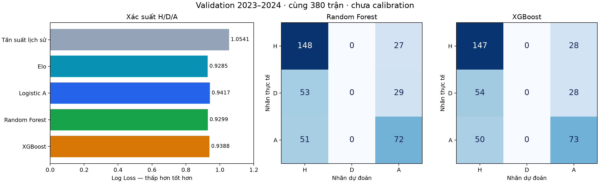
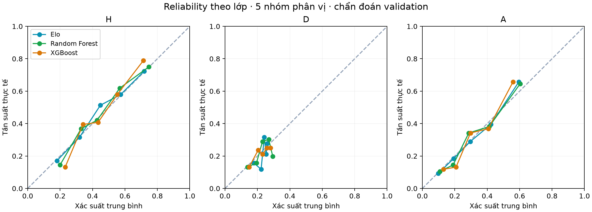

# So sánh Random Forest và XGBoost với baseline Model A

**Run A_trees_v1: chỉ development, chưa dự đoán hoặc tính metric test 2024–2025.**

## Kết quả chính

Random Forest và XGBoost đều đạt Accuracy 57,89%, nhưng Elo vẫn có Log Loss thấp nhất trên validation. Random Forest có Brier thấp nhất với chênh lệch nhỏ. Cả hai mô hình cây không chọn nhãn hòa lần nào; chưa giải quyết được hạn chế lớp D.

| Mô hình | Accuracy | Macro F1 | Log Loss ↓ | Brier ↓ |
|---|---:|---:|---:|---:|
| Tần suất lịch sử | 46.05% | 0.21021 | 1.05405 | 0.63710 |
| Elo | 57.11% | 0.41806 | 0.92848 | 0.54732 |
| Logistic A | 56.84% | 0.41817 | 0.94166 | 0.55520 |
| Random Forest | 57.89% | 0.42230 | 0.92986 | 0.54673 |
| XGBoost | 57.89% | 0.42317 | 0.93882 | 0.55193 |
| Luôn chọn H | 46.05% | 0.21021 | — | — |



Brier sử dụng tổng bình phương sai số ba lớp rồi lấy trung bình, miền [0,2]. Tất cả so sánh trên cùng 380 trận và cùng nhãn. Kết quả baseline được nạp từ run trước, kiểm tra ID, nhãn, metric và hash; không huấn luyện lại để chọn baseline thuận lợi hơn.

## Thiết kế đã ghi trước lượt chạy

- Huấn luyện cuối trên 3.040 trận 2015–2016 đến 2022–2023, đánh giá 380 trận 2023–2024. Hai mùa warm-up chỉ phục vụ tạo đặc trưng.
- Mỗi thuật toán thử bốn cấu hình trên ba fold walk-forward trong training: 2020–2021, 2021–2022, 2022–2023. Tổng cộng 24 lượt fit CV và hai lượt fit cuối. Logistic Regression trước đó cũng có bốn cấu hình; số ứng viên bằng nhau không có nghĩa chi phí tính toán hay độ rộng tìm kiếm tương đương.
- Chọn cấu hình theo Log Loss trung bình ba fold, không dùng điểm validation cuối để chọn tham số. Không early stopping, không đổi ngưỡng argmax, không cân bằng lớp, chưa calibration.
- Cùng 40 đặc trưng đầu vào. Median imputation và missing indicators fit riêng trong training từng fold. Mô hình cây không cần StandardScaler.
- Cấu hình này được ghi sau khi đã thấy kết quả Logistic/Elo, nhưng trước khi chạy RF/XGBoost. Đây là development tuần tự, không phải toàn bộ kế hoạch đã đăng ký trước khi xem bất kỳ validation nào.
- Thiết bị: CPU local, XGBoost device=cpu và tree_method=hist; n_jobs=2 ở cả hai mô hình. GPU không được dùng.
- Thời gian đo trong runner: 31.25 giây, gồm CV, fit cuối và diagnostics; không gồm cài thư viện hay dựng báo cáo. XGBoost 3.4.1; seed 42.
- Snapshot đặc trưng chỉ dùng các ngày lịch trước theo Europe/London. Thời điểm dữ liệu nguồn thực sự công bố chưa được chứng minh; giữ giới hạn tái dựng point-in-time như báo cáo trước.
- Shared outcomes được đọc để lọc ID development; ma trận đặc trưng test không được nạp, nhãn test không dùng cho fit/scoring.

## Lựa chọn siêu tham số

| Thuật toán | Ứng viên | Tham số thay đổi | Log Loss CV trung bình | SD giữa 3 mùa |
|---|---:|---|---:|---:|
| Random Forest | 1 | {"max_depth": 4, "min_samples_leaf": 30} | 1.000103 | 0.042811 |
| Random Forest | 0 | {"max_depth": 4, "min_samples_leaf": 10} | 1.000167 | 0.043346 |
| Random Forest | 3 | {"max_depth": 8, "min_samples_leaf": 30} | 1.002997 | 0.047519 |
| Random Forest | 2 | {"max_depth": 8, "min_samples_leaf": 10} | 1.009924 | 0.051705 |
| XGBoost | 0 | {"max_depth": 2, "n_estimators": 100} | 0.997000 | 0.041156 |
| XGBoost | 2 | {"max_depth": 3, "n_estimators": 100} | 1.000668 | 0.043472 |
| XGBoost | 1 | {"max_depth": 2, "n_estimators": 250} | 1.006157 | 0.048558 |
| XGBoost | 3 | {"max_depth": 3, "n_estimators": 250} | 1.014752 | 0.049826 |

Cấu hình được chọn: RF có 300 cây, max_depth=4, min_samples_leaf=30, max_features=0,7; XGBoost có max_depth=2, n_estimators=100, learning_rate=0,03, min_child_weight=10, reg_lambda=5, reg_alpha=0,1, subsample=colsample_bytree=0,8. Các tham số cố định khác nằm trong run_manifest.json. Điểm CV đã dùng chọn cấu hình không phải kết quả test độc lập.

## Độ bất định

Paired moving-block bootstrap theo tuần lịch, 2.000 lần, seed 42. Delta = Log Loss mô hình cây trừ mô hình tham chiếu; âm có lợi cho mô hình cây. Block chính là hai tuần; một và bốn tuần dùng phân tích độ nhạy.

| Mô hình | Tham chiếu | Block tuần | Delta | Khoảng percentile 95% |
|---|---|---:|---:|---|
| Random Forest | Elo | 1 | 0.00137 | [-0.00767; 0.01137] |
| Random Forest | Elo | 2 | 0.00137 | [-0.00760; 0.01052] |
| Random Forest | Elo | 4 | 0.00137 | [-0.00629; 0.01008] |
| Random Forest | Logistic A | 1 | -0.01181 | [-0.02842; 0.00188] |
| Random Forest | Logistic A | 2 | -0.01181 | [-0.02560; 0.00195] |
| Random Forest | Logistic A | 4 | -0.01181 | [-0.02333; 0.00202] |
| XGBoost | Elo | 1 | 0.01034 | [0.00043; 0.02100] |
| XGBoost | Elo | 2 | 0.01034 | [-0.00032; 0.02055] |
| XGBoost | Elo | 4 | 0.01034 | [-0.00006; 0.01963] |
| XGBoost | Logistic A | 1 | -0.00284 | [-0.01884; 0.01132] |
| XGBoost | Logistic A | 2 | -0.00284 | [-0.01809; 0.01179] |
| XGBoost | Logistic A | 4 | -0.00284 | [-0.01657; 0.01118] |

Tất cả bốn so sánh có khoảng chính hai tuần chứa 0; chưa có bằng chứng vững chắc rằng mô hình cây tốt hơn Elo hoặc Logistic A. XGBoost so với Elo có khoảng một tuần không chứa 0 theo hướng XGBoost kém hơn, nhưng kết luận này không bền qua các độ dài block. Đây là khoảng mô tả chưa điều chỉnh cho nhiều so sánh, chỉ resample một mùa với mô hình cố định, không phản ánh đầy đủ bất định do huấn luyện hoặc thay đổi giữa các mùa.

## Phân tích nhãn hòa và xác suất

Có 82 trận hòa thực tế. RF và XGBoost đều có recall D=0 vì không chọn D bằng argmax. Không sửa ngưỡng trên validation để làm đẹp kết quả. Xác suất D vẫn được dự đoán và tham gia đầy đủ vào Log Loss/Brier.

| Mô hình | Số dự đoán D | Recall D | Xác suất D trung bình | Tỷ lệ D thực tế |
|---|---:|---:|---:|---:|
| Tần suất lịch sử | 0 | 0.00% | 23.40% | 21.58% |
| Elo | 0 | 0.00% | 23.09% | 21.58% |
| Logistic A | 4 | 0.00% | 23.07% | 21.58% |
| Random Forest | 0 | 0.00% | 22.58% | 21.58% |
| XGBoost | 0 | 0.00% | 22.50% | 21.58% |



Đường reliability là chẩn đoán validation, chưa phải xác suất đã hiệu chỉnh. Tỷ lệ trung bình gần tỷ lệ thực tế chưa đảm bảo calibration từng trận. Wilson intervals trong CSV giả định độc lập, không dùng làm kiểm định chính thức cho chuỗi trận có phụ thuộc. Precision/recall/F1 đầy đủ từng lớp và confusion matrices nằm trong results.json.

## Vai trò các nhóm đặc trưng

Hoán vị đồng thời các cột trong từng nhóm, trong cùng tháng validation, 10 lần; không fit lại hoặc chọn lại tham số. SD dưới đây là độ biến thiên giữa các lần hoán vị, không phải khoảng tin cậy của tác động.

| Mô hình | Nhóm | Tăng Log Loss | SD hoán vị |
|---|---|---:|---:|
| Random Forest | elo | 0.19013 | 0.01851 |
| Random Forest | recent_form | 0.00059 | 0.00111 |
| Random Forest | venue_form | -0.00043 | 0.00036 |
| Random Forest | season_progress | 0.00323 | 0.00149 |
| Random Forest | rest | 0.00045 | 0.00026 |
| Random Forest | promotion | -0.00002 | 0.00003 |
| Random Forest | h2h | 0.00015 | 0.00019 |
| XGBoost | elo | 0.14586 | 0.01440 |
| XGBoost | recent_form | 0.00509 | 0.00204 |
| XGBoost | venue_form | 0.00117 | 0.00190 |
| XGBoost | season_progress | 0.00340 | 0.00175 |
| XGBoost | rest | 0.00026 | 0.00017 |
| XGBoost | promotion | 0.00000 | 0.00000 |
| XGBoost | h2h | -0.00048 | 0.00040 |

Nhóm Elo có tác động lớn nhất trong cả hai mô hình. Không suy ra quan hệ nhân quả hoặc lập tức bỏ nhóm có importance nhỏ/âm: các đặc trưng tương quan có thể thay thế nhau, và hoán vị tạo tổ hợp kém thực tế.

## Kiểm thử, lưu mô hình và bước kế tiếp

- 39 unit tests đạt, gồm bốn test mới cho mapping H/D/A, sai số float32, đủ fold cho mọi ứng viên và preprocessing chỉ fit trên training.
- Kiểm chứng artifact: hash cấu hình/đầu vào/code khớp; baseline cũ không đổi; cùng cohort 380 trận; nạp lại bundle và estimator riêng tái tạo xác suất; file XGBoost native UBJSON khớp pipeline; metric và confusion matrix tái tính khớp.
- XGBoost mã hóa H=0, D=1, A=2. Chuẩn hóa lại sai số softmax float32 nhỏ hơn 1e-6 trước scoring; xác suất sai lớn hơn bị từ chối. Không đổi định nghĩa metric hoặc thứ tự nhãn.
- Giữ Elo làm mốc so sánh mạnh. Chưa chọn mô hình cuối hoặc tuyên bố cây vượt baseline chỉ dựa trên Accuracy.
- Mốc tiếp theo nên tập trung audit lịch sử cầu thủ trong các mùa training để thiết kế so sánh A/P trên cùng cohort. Nếu không xác minh được announced XI ở T−60, chỉ dùng player/expected-lineup proxy từ quá khứ và không gọi đó là Model B/C đội hình chính thức.
- Sau khi chốt các nhóm đặc trưng và mô hình sẽ quyết định calibration, khóa cấu hình rồi mới chạy test cuối. Validation hiện đã được quan sát, không còn là tập kiểm tra độc lập chưa từng xem.

## Chạy và xem log

```powershell
python -m pip install -r requirements-modeling.txt
python -m unittest discover -s tests -v
python -u scripts/train_model_A_trees.py 2>&1 | Tee-Object -FilePath training-trees.log
python scripts/report_model_A_trees.py
```

Runner từ chối ghi đè nếu thư mục run đã tồn tại. Để chạy thí nghiệm mới, tạo cấu hình/run ID mới và điều chỉnh đường dẫn report tương ứng; không xóa kết quả cũ. Script report hiện trỏ tới A_trees_v1, chỉ xác minh và dựng lại báo cáo. Chỉ nạp joblib do dự án tạo từ nguồn tin cậy.

Tham khảo API: [XGBoost Python API](https://xgboost.readthedocs.io/en/stable/python/python_api.html), [RandomForestClassifier](https://scikit-learn.org/stable/modules/generated/sklearn.ensemble.RandomForestClassifier.html). Phiên bản thực thi được ghi trong run_manifest.json; tài liệu stable có thể mới hơn bản đã cài.
