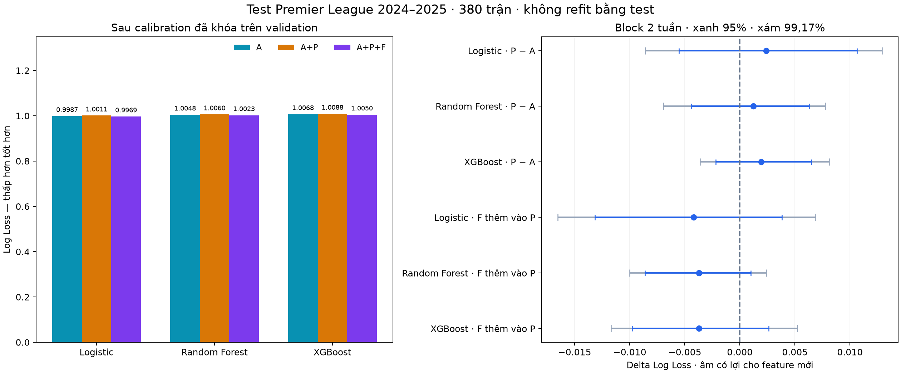
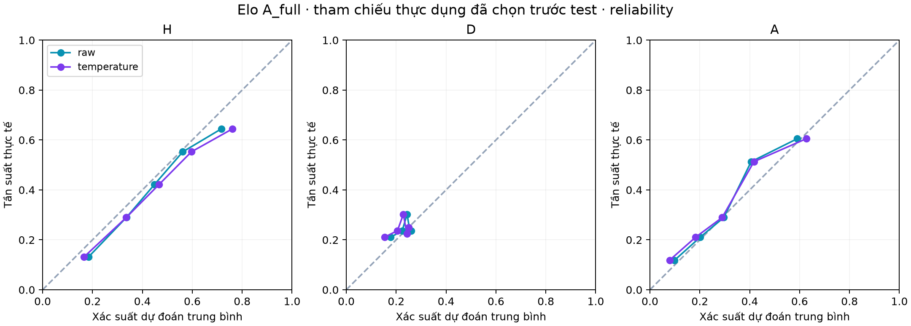

# Dự đoán xác suất kết quả Premier League mùa giải 2024 2025

Bài tập lớn môn Khai phá và Phân tích dữ liệu
Báo cáo thực nghiệm hoàn thành ngày 24 tháng 10 năm 2026

## Tóm tắt

Nghiên cứu xây dựng hệ thống dự đoán xác suất ba kết quả chủ nhà thắng, hòa và đội khách thắng của từng trận Premier League. Dữ liệu miễn phí được kiểm định và chuẩn hóa trước khi tạo thống kê theo thời gian. Nhánh A sử dụng phong độ và Elo cấp đội; P bổ sung lịch sử sử dụng nhân sự; F bổ sung hiệu suất bàn thắng và kiến tạo của nhóm cầu thủ tham gia trận trước. Các nhánh cầu thủ được so sánh trên cùng tập trận để giảm sai lệch do khác giai đoạn dữ liệu.

Trên 380 trận test mùa 2024–2025, Elo A_full đã được chọn trước test làm tham chiếu đạt Accuracy 54,74%, Macro F1 0,41096 và Log Loss gốc 0,98141. Temperature scaling fit trên validation 2023–2024 làm Log Loss test tăng ở cả 14 estimator. Sáu so sánh chính về P/F chưa cho thấy cải thiện chắc chắn; mọi khoảng điều chỉnh cho nhiều so sánh tại block chính đều chứa 0. Kết quả nhấn mạnh giá trị của baseline mạnh và đánh giá xác suất ngoài mẫu.

Hệ thống là backtest hồi cứu theo ngày. Chưa xác minh announced XI và thời điểm nguồn công bố tại T−60, nên không suy diễn kết quả proxy thành kết luận về đội hình chính thức hoặc giá trị thị trường. Đóng góp trọng tâm là quy trình chống rò rỉ, audit có bằng chứng, ablation công bằng và lịch sử thí nghiệm truy vết được.

| Quy mô | Giá trị |
| --- | --- |
| Dữ liệu đội | 12 mùa gồm 2 mùa warm-up |
| Lịch sử cầu thủ chuẩn hóa | 128.543 dòng development, 1.900 trận |
| Vòng test đã khóa | 380 trận, 30 đầu ra xác suất |
| Kiểm thử trước test | 81 unit tests và các kiểm tra thời gian trên dữ liệu thật |

## 1 Vấn đề nghiên cứu và cơ sở phương pháp

Mục tiêu là ước lượng xác suất cho H, D, A thay vì chỉ chọn một nhãn. Hai trận đều được dự đoán H có thể có mức chắc chắn rất khác nhau; vì vậy Accuracy chưa đủ phản ánh chất lượng dự đoán. Nghiên cứu ưu tiên Log Loss và Brier, đồng thời báo chất lượng phân loại từng lớp.

Câu hỏi khả thi với dữ liệu đã thu thập là liệu lịch sử sử dụng và đóng góp cầu thủ có bổ sung tín hiệu cho thống kê đội hay không. Câu hỏi ban đầu về XI chính thức, tuổi và market value cần bằng chứng thời điểm công bố mà các bảng tải được chưa cung cấp. Nghiên cứu giữ phần đó thành giới hạn dữ liệu, không thay thế bằng thông tin sau trận rồi coi là đầu vào trước trận.

Logistic Regression đa lớp là đối chứng dễ kiểm toán và có regularization. Random Forest kiểm tra quan hệ phi tuyến mà không cần chuẩn hóa thang đo. XGBoost là thuật toán boosting trên cây được mô tả bởi Chen và Guestrin [4]. Quy mô vài nghìn trận không tạo lý do bắt buộc phải dùng Deep Learning; nghiên cứu giới hạn số cấu hình để kiểm soát chi phí và mức thử nghiệm.

Guo và cộng sự trình bày temperature scaling như phương pháp hậu xử lý một tham số [5]. Kết quả của họ không bảo đảm phương pháp luôn cải thiện trên dữ liệu bóng đá theo mùa. Trong dự án, phương pháp được fit trên mùa validation rồi đánh giá ngoài mẫu ở mùa tiếp theo. Pipeline chỉ fit các phép tiền xử lý trên training theo hướng dẫn kiểm soát data leakage của scikit-learn [3].

| Câu hỏi | Thực nghiệm trả lời |
| --- | --- |
| Thống kê đội dự đoán được đến đâu | A_full và các baseline xác suất |
| Mức sử dụng cầu thủ có bổ sung tín hiệu | A_common so với A+P |
| Phong độ đóng góp có bổ sung thêm | A+P so với A+P+F |
| Calibration có tổng quát hóa sang mùa sau | Raw và temperature trên test |
| XI và market value chính thức có tác động không | Chưa đủ điều kiện dữ liệu để kết luận |

Không tối ưu Accuracy bằng cách thay ngưỡng lớp hòa sau khi xem test. Các lỗi dự đoán hòa, kết quả không cải thiện và sự suy giảm sau calibration đều được công bố.

## 2 Dữ liệu và kiểm định chất lượng

Football-Data.co.uk cung cấp CSV trận EPL cho 2013–2014 đến 2024–2025 trong bộ dữ liệu tải thực tế [1]. Mỗi mùa có 380 trận sau chuẩn hóa; hai mùa đầu phục vụ warm-up. Nguồn cầu thủ là archive FPL của vaastav, được tải và lưu checksum từng file [2]. Giá FPL không đồng nhất với market value. Các nguồn FBref, Transfermarkt/Kaggle và football-data.org được nghiên cứu ở giai đoạn khả thi nhưng không được dùng để giả định có XI hoặc valuation lịch sử hợp lệ.

| Mùa cầu thủ | Dòng raw | Tình trạng chuẩn hóa |
| --- | --- | --- |
| 2016–2017 | 23.679 | Thiếu tệp fixtures và teams ở đường dẫn kiểm tra |
| 2017–2018 | 22.467 | Thiếu tệp fixtures và teams ở đường dẫn kiểm tra |
| 2018–2019 | 21.790 | Thiếu tệp teams ở đường dẫn kiểm tra |
| 2019–2020 | 22.560 | 22.501 dòng sau loại placeholder, ghép 380 trận |
| 2020–2021 | 24.365 | Ghép đủ 380 trận |
| 2021–2022 | 25.447 | Ghép đủ 380 trận |
| 2022–2023 | 26.505 | Ghép đủ 380 trận, advanced stats có khoảng thiếu |
| 2023–2024 | 29.725 | Ghép đủ 380 trận validation |

Mùa 2019–2020 có 59 khóa player–fixture lặp tại trận Man City–Arsenal bị hoãn. Bản ngày 11/03/2020 có minutes=0 và tỷ số trống; từng cầu thủ có bản thay thế ở trận ngày 17/06/2020. Chỉ loại placeholder khi thỏa đầy đủ quy tắc đã ghi và đối chiếu thông báo Premier League [7]. Raw vẫn giữ nguyên; không dùng thao tác giữ dòng cuối tùy tiện.

Trong 136 trận đầu mùa 2022–2023, starts, xG và xA của toàn trận đều bằng 0; chỉ 244 trận có tổng 22 recorded starts. Bộ ba toàn 0 bị đánh dấu không dùng được ở bảng chuẩn hóa, còn số 0 hợp lệ của một cá nhân được giữ. P/F không dùng các cột này. Test 2024–2025 loại thêm 322 dòng Assistant Manager trước khi tạo feature.

Đội tại trận được lấy từ fixture và was_home, không từ đội cuối mùa của cầu thủ. ID cầu thủ có season scope. Tên, mùa, đội và ngày trận được ghép có kiểm tra một-một hoặc nhiều-một rõ ràng. Khác giờ trong cùng ngày được giữ cả hai bản và gắn cờ; không tự coi lịch archive là lịch đã biết tại thời điểm dự đoán.

## 3 Dataset và kiểm soát rò rỉ theo thời gian

| Nhánh | Training | Validation | Testing |
| --- | --- | --- | --- |
| A_full | 2015–2023, 3.040 trận | 2023–2024, 380 | 2024–2025, 380 |
| A_common | 2019–2023, 1.520 trận | Cùng 380 trận | Cùng 380 trận |
| A+P | Cùng 1.520 trận | Cùng 380 trận | Cùng 380 trận |
| A+P+F | Cùng 1.520 trận | Cùng 380 trận | Cùng 380 trận |

Luồng xử lý gồm raw bất biến, bảng chuẩn hóa có ID và thời gian, rồi feature snapshots. Match outcomes tách khỏi ma trận đầu vào. Mỗi snapshot có lineage lưu trận nguồn và availability giả định lớn nhất. Dự đoán được tạo trước khi cập nhật trạng thái từ kết quả cả ngày; mọi trận trong cùng ngày dùng thông tin từ các ngày trước.

Nếu chỉ có ngày thi đấu, không tự gán giờ 15:00. Bản tái dựng dùng 00:00 Europe/London của ngày hiện tại làm mốc trạng thái và giả định thông tin trận trước có vào nửa đêm kế tiếp. Quy tắc này bảo thủ với các trận cùng ngày nhưng vẫn chưa chứng minh publication time lịch sử. Múi giờ địa phương xử lý DST, không cộng cố định 24 giờ theo UTC.

Elo và form cấp đội được cập nhật tuần tự. Phong độ có thể đi qua hai mùa liên tiếp của cùng đội; đội mới lên hạng được khởi tạo theo quy tắc cố định. P/F reset đầu mùa vì chưa nối identity cầu thủ xuyên mùa. Không backfill dữ liệu tương lai, không dùng thứ hạng cuối mùa hoặc thống kê của trận đang dự đoán.

Days since last PL match chỉ đo lịch EPL, không được gọi là thời gian nghỉ ở mọi đấu trường. Sporting points là 3W+D, chưa bao gồm lịch sử quyết định trừ điểm. Những giới hạn này được thể hiện bằng tên feature và từ điển dữ liệu, thay vì trình bày như trạng thái chính thức đầy đủ.

| Nhóm kiểm tra | Điều kiện phải đúng |
| --- | --- |
| Trận hiện tại | Đổi outcome hoặc minutes/goals/assists không đổi feature của chính trận đó |
| Tương lai | Thay dữ liệu các trận sau không làm đổi feature trước đó |
| Prefix và thứ tự | Tính trên prefix khớp full history; đảo input không đổi kết quả |
| Join và lineage | ID duy nhất, đúng phía đội, không vượt cutoff giả định |
| Tiền xử lý | Imputer/scaler chỉ fit trên training của từng fold |

## 4 Biểu diễn đội bóng và lịch sử cầu thủ

A có 40 cột số gồm Elo home/away và chênh lệch, phong độ 5/10 trận, hiệu suất sân nhà/sân khách, sporting points/PPG/GD trước trận, số trận hỗ trợ, ngày từ trận EPL gần nhất, cờ thiếu lịch sử/mới lên hạng và H2H. Không có odds, nhãn hiện tại hoặc thống kê phát sinh trong trận.

| Đại lượng P mỗi phía | Ý nghĩa trong tối đa 5 trận trước |
| --- | --- |
| Số trận lịch sử | 0–5, hỗ trợ diễn giải missing |
| Số người có phút dương | Số player-season ID từng tham gia |
| HHI phút thi đấu | Mức tập trung tổng phút vào ít người |
| Tỷ trọng phút top 11 | Tổng tỷ trọng phút của 11 người được dùng nhiều nhất |
| Tỷ trọng phút người quay lại | Phút trận trước thuộc người đã tham gia sớm hơn trong cửa sổ |
| Overlap phút trung bình | Tổng min của tỷ trọng phút qua từng cặp trận liền nhau |

P có 12 cột vì tính sáu đại lượng cho hai phía. Không có lịch sử thì số trận bằng 0 và các đại lượng khác missing; continuity cần ít nhất hai trận. Nhóm top 11 là mô tả lịch sử mức sử dụng, không phải starting XI hiện tại. Dòng không có phút dương không tạo người tham gia trong cửa sổ.

F thêm bốn đại lượng mỗi phía. Rate cá nhân lấy tổng bàn hoặc kiến tạo trong cửa sổ nhân 90, rồi chia tổng phút cộng 180. Rate nhóm là tổng có trọng số, trong đó trọng số là tỷ trọng phút của người đó ở trận trước gần nhất. 180 phút là prior cố định về rate 0, ghi trước khi đo F; mục đích là tránh per90 rất lớn từ mẫu ít phút.

Hai đại lượng F còn lại là HHI đóng góp G+A và phần đóng góp trong cửa sổ thuộc nhóm người tham gia trận trước gần nhất. Tổng đóng góp bằng 0 khiến các tỷ trọng missing; đây không phải số 0 quan sát được. Không có lịch sử thì cả bốn missing. Mỗi bên được xử lý cùng công thức, không dùng current roster để chọn người.

Assists sử dụng định nghĩa FPL. P/F chỉ dùng lịch sử của chính đội, không tự mang phong độ xuyên CLB hoặc qua mùa. Người chuyển đi có thể vẫn nằm trong lịch sử; thiếu roster đúng thời điểm làm proxy có sai số. Các cột xG/xA, starts, tuổi, market value và chấn thương được loại khỏi các phiên bản đã thực nghiệm.

## 5 Mô hình đánh giá và calibration

| Thuật toán | Bốn ứng viên trong mỗi nhánh |
| --- | --- |
| Logistic Regression | C ∈ {0,01; 0,1; 1; 10}, L2, multinomial |
| Random Forest | max_depth ∈ {4;8} × min_samples_leaf ∈ {10;30}, 300 cây |
| XGBoost | max_depth ∈ {2;3} × n_estimators ∈ {100;250}, learning_rate 0,03 |

Mỗi nhánh chọn tham số riêng bằng Log Loss trung bình ba fold expanding-window trong training. Với common: train 380, 760 và 1.140 trận để đánh giá từng mùa 2020–2021, 2021–2022 và 2022–2023, mỗi fold 380 trận. Median imputation và missing indicators được fit riêng từng fold; Logistic thêm StandardScaler. Không class weighting, không early stopping bằng validation cuối, không đổi ngưỡng theo test.

Baseline xác suất gồm tần suất H/D/A từ training với Laplace smoothing và Logistic ba lớp trên riêng elo_diff. Expected score của Elo không được coi trực tiếp là xác suất thắng do còn lớp hòa. Luôn chọn H chỉ có metric phân loại, không gán xác suất 0 để đánh giá Log Loss.

Log Loss = −mean(log xác suất của nhãn đúng).

Brier = mean(tổng bình phương sai số ba xác suất so với vector one-hot).

N là số trận; p là xác suất theo thứ tự H,D,A. Trong Log Loss, y là nhãn đúng; trong Brier, y theo hai chỉ số là biến chỉ báo one-hot của lớp. Brier dùng tổng ba lớp rồi lấy trung bình, miền [0,2]. Accuracy, Macro F1, precision/recall từng lớp, confusion matrix và reliability bổ sung việc đánh giá xác suất. Nhãn được lấy bằng argmax.

p_calibrated = softmax(log(p) / T).

Fit một T cho mỗi estimator trên 380 trận validation 2023–2024, với T trong [0,5;5] và có phương án T=1. Điểm validation sau fit là diagnostic in-sample. Base estimators không refit lên validation. Temperature giữ argmax nên không tự sửa recall hòa [6]. Hai baseline tần suất giữ raw.

So sánh ghép cặp dùng moving-block bootstrap theo tuần lịch, 2.000 lần, seed 42. Block chính hai tuần; một/bốn tuần là độ nhạy. Sáu contrast temperature là phân tích chính: P trừ A và APF trừ AP cho ba thuật toán. Báo CI 95% cùng khoảng Bonferroni-style 99,1667%; độ phủ chỉ xấp xỉ và số mẫu đuôi hữu hạn.

## 6 Kết quả development trên validation

Ở A_full, Elo đạt Log Loss 0,92848; Random Forest 0,92986; XGBoost 0,93882; Logistic 0,94166. Elo A_full được chọn làm tham chiếu thực dụng trước khi mở test. Mọi so sánh P/F bên dưới dùng cohort common train 1.520 trận; không quy chênh lệch với A_full train 3.040 trận thành tác dụng của feature.

| Thuật toán | Nhánh | Accuracy | Macro F1 | Log Loss raw |
| --- | --- | --- | --- | --- |
| Logistic Regression | A | 56.32% | 0.4143 | 0.94246 |
| Logistic Regression | A+P | 57.11% | 0.4264 | 0.94449 |
| Logistic Regression | A+P+F | 56.84% | 0.4246 | 0.95347 |
| Random Forest | A | 56.05% | 0.4135 | 0.93906 |
| Random Forest | A+P | 56.05% | 0.4140 | 0.94054 |
| Random Forest | A+P+F | 56.32% | 0.4156 | 0.93980 |
| XGBoost | A | 56.58% | 0.4164 | 0.94541 |
| XGBoost | A+P | 58.16% | 0.4281 | 0.94483 |
| XGBoost | A+P+F | 56.05% | 0.4124 | 0.94468 |

P chưa cải thiện Log Loss rõ ràng. XGBoost A+P tăng Accuracy lên 58,16% nhưng mức giảm Log Loss nhỏ; cả chín CI bootstrap theo block 1/2/4 tuần đều chứa 0. Thêm F làm Logistic kém hơn trên điểm ước lượng, trong khi RF/XGBoost giảm Log Loss rất ít so với A+P. Đây là lý do cần giữ metric xác suất làm tiêu chí chính.

Feature importance theo nhóm được thực hiện trên validation bằng hoán vị các cột cùng nhóm trong từng tháng. Elo là nhóm có tác động lớn nhất trong mô hình A đã fit. Tác động P/F nhỏ hoặc không ổn định; các đặc trưng tương quan có thể thay thế nhau và hoán vị có thể tạo tổ hợp ít thực tế. Không diễn giải các giá trị này như quan hệ nhân quả.

Development diễn ra theo từng phiên bản sau khi đã xem validation ở các bước trước. Mỗi lượt giữ cấu hình ghi trước fit, nhưng không gọi validation là tập chưa từng quan sát. Sau phiên bản F đã đăng ký, dự án dừng mở rộng cửa sổ, shrinkage, lưới hoặc thuật toán để tìm điểm tốt hơn; mọi kết quả không cải thiện được giữ lại.

## 7 Kết quả test cuối mùa 2024 2025

Trước scoring, danh sách 14 estimator, hai baseline, 14 nhiệt độ, feature và mã được khóa bằng SHA-256. Commit khóa là 7773397; kết quả được lưu sau đó tại b36fb63. Runner lưu đủ xác suất trước khi ghép nhãn để tính metric. Không refit estimator/calibrator trong test; trạng thái lịch sử được cập nhật từ các ngày test trước theo quy tắc đã chốt.

| Tham chiếu Elo A_full | Raw | Temperature |
| --- | --- | --- |
| Accuracy | 54,74% | 54,74% |
| Macro F1 | 0,41096 | 0,41096 |
| Log Loss | 0,98141 | 0,98606 |
| Brier | 0,58654 | 0,58993 |

| Thuật toán | Cohort và nhánh | Accuracy | LL raw | LL temp |
| --- | --- | --- | --- | --- |
| Elo | Full/Full | 54.74% | 0.98141 | 0.98606 |
| Logistic | Full/Full | 52.11% | 0.99114 | 0.99403 |
| Random Forest | Full/Full | 51.32% | 1.00598 | 1.01080 |
| XGBoost | Full/Full | 51.84% | 1.00575 | 1.01215 |
| Tần suất lịch sử | Full/Full | 40.79% | 1.08089 | — |
| Elo | Common/A | 54.47% | 0.98025 | 0.98470 |
| Tần suất lịch sử | Common/A | 40.79% | 1.07920 | — |
| Logistic | Common/A | 53.16% | 0.99430 | 0.99869 |
| Logistic | Common/A+P | 51.05% | 0.99688 | 1.00107 |
| Logistic | Common/APF | 52.63% | 0.99557 | 0.99688 |
| Random Forest | Common/A | 53.68% | 0.99978 | 1.00475 |
| Random Forest | Common/A+P | 53.68% | 1.00118 | 1.00599 |
| Random Forest | Common/APF | 53.42% | 0.99871 | 1.00227 |
| XGBoost | Common/A | 52.37% | 1.00105 | 1.00683 |
| XGBoost | Common/A+P | 52.89% | 1.00247 | 1.00876 |
| XGBoost | Common/APF | 53.68% | 1.00012 | 1.00505 |

Test có H/D/A = 155/93/132. Luôn chọn chủ nhà đạt 40,79% Accuracy. Cả 14 mô hình có Log Loss và Brier tăng sau temperature. Không chọn lại raw/calibrated sau khi thấy test; bảng giữ cả hai theo protocol. Chi tiết Brier, F1 và confusion matrices mọi mô hình nằm trong báo cáo kết quả đầy đủ.

## 8 Đóng góp bổ sung của P và F trên test

So sánh chính sử dụng temperature đã fit trước test. Delta là Log Loss mô hình thêm feature trừ đối chứng cùng thuật toán và cohort; âm có lợi cho feature mới. Cả sáu khoảng chính, kể cả CI 95%, đều chứa 0. Không coi điều này là bằng chứng hai mô hình tương đương hoặc mọi dữ liệu cầu thủ đều không hữu ích.

| Thuật toán | Contrast | Delta | CI 95% | CI 99,1667% |
| --- | --- | --- | --- | --- |
| Logistic | P − A | +0.00238 | [-0.00554; 0.01063] | [-0.00859; 0.01292] |
| Random Forest | P − A | +0.00124 | [-0.00439; 0.00627] | [-0.00695; 0.00776] |
| XGBoost | P − A | +0.00193 | [-0.00219; 0.00649] | [-0.00362; 0.00810] |
| Logistic | APF − AP | -0.00419 | [-0.01315; 0.00381] | [-0.01653; 0.00686] |
| Random Forest | APF − AP | -0.00372 | [-0.00861; 0.00099] | [-0.01000; 0.00239] |
| XGBoost | APF − AP | -0.00372 | [-0.00977; 0.00261] | [-0.01169; 0.00521] |

P làm Log Loss tăng ở cả ba thuật toán trên ước lượng điểm. F làm giảm Log Loss so với A+P, nhưng mức giảm khoảng 0,0037–0,0042 chưa tách rõ khỏi nhiễu của một mùa. Kết quả raw và độ nhạy block một/bốn tuần đều được lưu, không chọn block thuận lợi để thay kết luận chính.

Các khoảng giữ cố định mô hình, chưa bao gồm bất định do huấn luyện lại hoặc biến động giữa nhiều mùa. Hiệu chỉnh Bonferroni-style không làm các giả định bootstrap trở thành đúng tuyệt đối; 2.000 resample cũng tạo giới hạn khi ước lượng đuôi 99,1667%.

## 9 Thảo luận giới hạn và kết luận

Elo A_full không chọn nhãn hòa lần nào, recall D bằng 0 dù test có 93 trận hòa. Temperature giữ nguyên nhãn nên không giải quyết hạn chế này. Xác suất D vẫn được tính đầy đủ vào Log Loss/Brier; việc không chọn D không đồng nghĩa p(D)=0. Báo cáo không che điểm yếu bằng Accuracy tổng.

Tất cả T dưới 1 làm dự đoán sắc hơn theo validation, nhưng ngoài mẫu lại tăng loss. Tỷ lệ chủ nhà thắng giảm từ 46,05% ở validation xuống 40,79% ở test, hòa tăng từ 21,58% lên 24,47%. Đây là khác biệt mô tả giữa hai mùa, chưa chứng minh nguyên nhân calibration thất bại. Quan hệ giữa đặc trưng và nhãn cũng có thể thay đổi; một mùa calibration nhỏ không bảo đảm tổng quát hóa.

Các giới hạn dữ liệu gồm chưa xác minh publication time, thiếu announced XI và market value đúng thời điểm, không nối player identity xuyên mùa, roster hiện tại không biết đầy đủ, assists theo FPL và rest days chỉ theo EPL. Dữ liệu archive có thể đã được sửa về sau. Vì vậy kết quả là backtest hồi cứu có giả định, không phải chứng minh hệ thống live tại T−60 với feed đầy đủ.

Kết luận được hỗ trợ là: trong cohort và các phiên bản đã định nghĩa, proxy nhân sự/đóng góp cầu thủ chưa tạo cải thiện Log Loss chắc chắn; baseline Elo là đối chứng mạnh và temperature fit mùa trước làm chất lượng xác suất test giảm trong thí nghiệm này. Không suy rộng thành “cầu thủ không quan trọng” hoặc “calibration luôn có hại”. Hướng mở rộng dữ liệu tương lai là XI có timestamp, roster/identity và nguồn performance nhất quán; phải dùng một giai đoạn đánh giá mới.

## 10 Tái lập sản phẩm và tài liệu tham khảo

Bộ bàn giao có báo cáo Word và Markdown, notebook đã thực thi, demo HTML offline và các artifact kết quả/khóa thí nghiệm. Notebook tự tính lại metric từ xác suất đã lưu; demo chỉ đổi góc xem trên archive. Cả hai không huấn luyện hoặc chọn lại mô hình. Full reproduction từ raw cần đúng snapshot, phiên bản thư viện và model artifacts, không thể đồng nhất với việc đọc lại CSV kết quả.

Đã có 81 unit tests trước vòng test và các kiểm tra prefix, current/future perturbation, thứ tự input, DST và lineage trên dữ liệu thật. Nạp lại artifact cuối tái tạo đủ 11.400 bộ xác suất cùng mọi metric/confusion matrix, sai số xác suất tối đa khoảng 3,33×10⁻¹⁶. Notebook có 10 ô mã chạy thành công; demo được kiểm tra desktop/mobile, bộ lọc/empty state, ẩn kết quả thật và không gọi mạng.

Để trình bày: mở demo/index.html, chọn trận/mô hình, đọc xác suất raw và temperature, rồi bật kết quả thực tế. Khi giải thích, nhấn mạnh khác biệt giữa dự đoán xác suất và kết quả được bảo đảm, giữa proxy nhóm trận trước và đội hình chính thức. Không sửa mô hình từ lỗi test để tái dùng mùa này như một tập chưa từng quan sát.

[1] Football-Data.co.uk. England historical results CSV. https://www.football-data.co.uk/englandm.php

[2] Vaastav. Fantasy Premier League historical archive và LICENSE. https://github.com/vaastav/Fantasy-Premier-League

[3] scikit-learn. Common pitfalls and recommended practices, Data leakage. https://scikit-learn.org/stable/common_pitfalls.html

[4] Chen, T. và Guestrin, C. (2016). XGBoost A Scalable Tree Boosting System. https://arxiv.org/abs/1603.02754

[5] Guo, C., Pleiss, G., Sun, Y. và Weinberger, K. Q. (2017). On Calibration of Modern Neural Networks. PMLR 70, 1321–1330. https://proceedings.mlr.press/v70/guo17a.html

[6] scikit-learn. Probability calibration, Temperature scaling. https://scikit-learn.org/stable/modules/calibration.html

[7] Premier League (2020). Man City v Arsenal postponed và initial fixtures for season restart. https://www.premierleague.com/en/news/1643922 ; https://www.premierleague.com/en/news/1676717

[8] Artifact nội bộ dự án. final_evaluation_config.json, final_model_registry.json, final_lock.json; reports/final_test_v1/results.json và artifact_verification.json. Khóa trước scoring: commit 7773397.

Thời điểm kiểm chứng nguồn và thực nghiệm: tháng 10 năm 2026. Các con số là kết quả thực nghiệm đã lưu, không phải dữ liệu minh họa. Raw và model artifacts giữ cục bộ; giấy phép mã nguồn không mặc nhiên tái cấp phép dữ liệu bên thứ ba.
