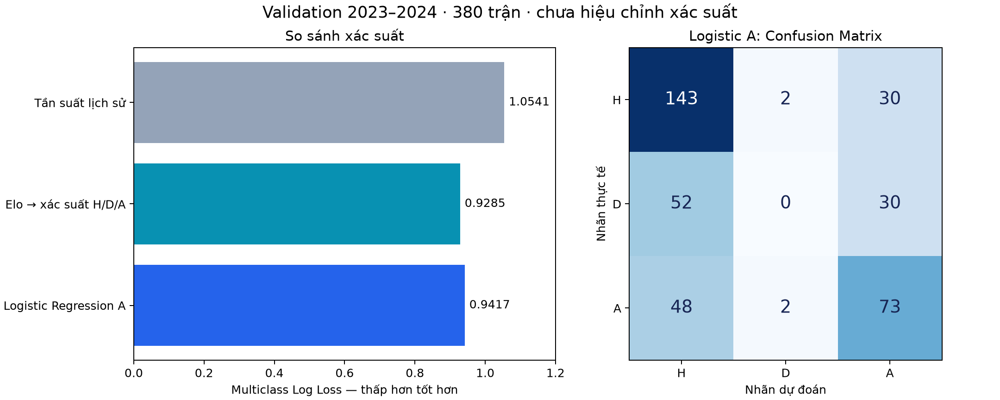
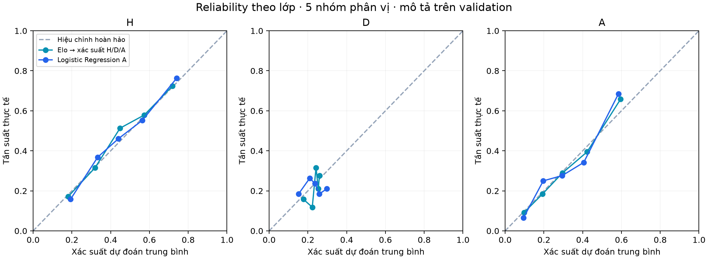

# Model A: baseline và Logistic Regression — kết quả development

Run `A_dev_v1`; dữ liệu miễn phí; kết quả thực nghiệm trên 380 trận validation 2023–2024. **Chưa tính metric hay tạo dự đoán test 2024–2025.**

## Thiết kế và khả năng tái lập

- Training cuối: 3.040 trận, 2015–2016 đến 2022–2023. Hai mùa warm-up chỉ khởi tạo trạng thái đặc trưng.
- Chọn C bằng Log Loss trung bình của ba fold walk-forward trong training: 2020–2021, 2021–2022, 2022–2023; lần lượt có 1.900, 2.280 và 2.660 trận huấn luyện. Mỗi fold kiểm tra 380 trận.
- Median imputation, missing indicators và StandardScaler được fit riêng trên training của từng fold. Logistic Regression đa lớp dùng L2, không class weighting; không có cảnh báo hội tụ.
- Elo baseline học ánh xạ ba lớp từ riêng elo_diff; không coi expected score của Elo là xác suất thắng. Baseline tần suất dùng Laplace smoothing alpha=1. Luôn chọn H chỉ có metric phân loại.
- Cấu hình được ghi trước lần chạy đầu. Không dùng validation 2023–2024 để chọn C, không hiệu chỉnh xác suất hậu nghiệm trong run này.
- Đặc trưng chỉ dùng trận đã kết thúc ở các ngày lịch trước theo Europe/London. Đây là tái dựng với giả định dữ liệu có vào nửa đêm tiếp theo, chưa xác minh thời điểm nguồn công bố; không khẳng định là feed point-in-time đã chứng minh đầy đủ tại T−60.
- File outcomes chung được đọc để lọc ID development; nhãn test không được giữ lại cho fit/scoring. Không tải ma trận đặc trưng test vào mô hình.

| C | Log Loss trung bình walk-forward | Độ lệch chuẩn giữa 3 mùa |
|---:|---:|---:|
| 0.01 | 1.005453 | 0.045841 |
| 0.1 | 1.019155 | 0.053805 |
| 1 | 1.029386 | 0.053023 |
| 10 | 1.041422 | 0.052939 |

**Chọn C=0,01.** Điểm CV đã dùng chọn siêu tham số nên không phải ước lượng test độc lập. C tốt nhất nằm ở biên dưới lưới; chưa mở rộng lưới sau khi nhìn validation.

## Kết quả validation

| Mô hình | Accuracy | Macro F1 | Log Loss ↓ | Brier ↓ |
|---|---:|---:|---:|---:|
| Tần suất lịch sử | 46.05% | 0.2102 | 1.0541 | 0.6371 |
| Elo → xác suất H/D/A | 57.11% | 0.4181 | 0.9285 | 0.5473 |
| Logistic Regression A | 56.84% | 0.4182 | 0.9417 | 0.5552 |
| Luôn chọn chủ nhà | 46.05% | 0.2102 | — | — |

Brier = trung bình tổng bình phương sai số của ba xác suất, miền [0,2]. Thứ tự xác suất và confusion matrix luôn H, D, A. Nhãn dự đoán là argmax.



Elo đạt Log Loss tốt nhất trong các mô hình đã chạy. Bổ sung cả 40 đặc trưng vào Logistic Regression chưa cải thiện so với Elo trên mùa này; không đủ cơ sở để kết luận các đặc trưng đó vô dụng cho mọi thuật toán hay mùa giải.

### Độ bất định của chênh lệch

Paired moving-block bootstrap theo tuần lịch, 2.000 lần, seed 42. Delta = Log Loss Logistic A trừ baseline; âm có lợi cho Logistic A.

| Baseline | Độ dài block (tuần) | Delta | Khoảng percentile 95% |
|---|---:|---:|---|
| Tần suất lịch sử | 1 | -0.11239 | [-0.15928; -0.06294] |
| Tần suất lịch sử | 2 | -0.11239 | [-0.15643; -0.05981] |
| Tần suất lịch sử | 4 | -0.11239 | [-0.14947; -0.05440] |
| Elo → xác suất H/D/A | 1 | 0.01318 | [0.00021; 0.02793] |
| Elo → xác suất H/D/A | 2 | 0.01318 | [-0.00060; 0.02694] |
| Elo → xác suất H/D/A | 4 | 0.01318 | [0.00067; 0.02267] |

So với tần suất lịch sử, Logistic A cải thiện trong cả ba lựa chọn block. So với Elo, chênh lệch điểm là +0,01318; khoảng chính với block 2 tuần chứa 0, còn block 1 và 4 tuần không chứa 0. Kết luận về độ chắc chắn nhạy với cách resample; không tuyên bố khác biệt có ý nghĩa thống kê vững chắc. Các khoảng chỉ phản ánh resampling một mùa với mô hình cố định, không bao gồm bất định do huấn luyện hoặc thay đổi giữa các mùa.

## Lỗi dự đoán hòa và chất lượng xác suất

Validation có H=175, D=82, A=123. Elo không chọn nhãn D lần nào. Logistic A chọn D bốn lần và đều sai; recall lớp D bằng 0 ở cả hai. Điều này là hạn chế nghiêm trọng của phân loại ba nhãn, dù các mô hình vẫn xuất xác suất hòa khác 0.

| Mô hình | Xác suất D trung bình | Tỷ lệ hòa thực tế |
|---|---:|---:|
| Tần suất lịch sử | 23.40% | 21.58% |
| Elo → xác suất H/D/A | 23.09% | 21.58% |
| Logistic Regression A | 23.07% | 21.58% |

Xác suất trung bình gần tỷ lệ thực tế chưa chứng minh hiệu chỉnh tốt cho từng trận. Biểu đồ reliability dưới đây là chẩn đoán trên validation, không phải kết quả sau calibration.



File reliability_bins.csv có Wilson intervals mô tả theo bin; các khoảng này giả định quan sát độc lập, không xử lý đầy đủ phụ thuộc giữa trận đấu, vì vậy không dùng làm kiểm định hiệu chỉnh chính thức.

## Giải thích mô hình

Permutation importance hoán vị đồng thời các cột cùng nhóm trong từng tháng validation, 10 lần; không fit lại hay chọn lại mô hình. Giá trị dương là Log Loss tăng khi phá thông tin nhóm đó.

| Nhóm | Tăng Log Loss trung bình | Độ lệch chuẩn 10 lần |
|---|---:|---:|
| elo | 0.18142 | 0.01987 |
| recent_form | 0.00671 | 0.00327 |
| season_progress | 0.00356 | 0.00405 |
| rest | 0.00216 | 0.00312 |
| promotion | 0.00041 | 0.00329 |
| venue_form | -0.00085 | 0.00183 |
| h2h | -0.00250 | 0.00164 |

Elo là nhóm có tác động lớn nhất trong mô hình đã fit. Các nhóm còn lại có tác động nhỏ; H2H và venue có trung bình âm. Đây là chẩn đoán phụ thuộc mô hình và cách hoán vị, không phải quan hệ nhân quả hay bằng chứng chắc chắn nên bỏ nhóm. Tương quan giữa các nhóm có thể tạo tổ hợp đặc trưng ít thực tế khi hoán vị. Hệ số đã chuẩn hóa được xuất riêng, không diễn giải là tác động nhân quả.

## Kiểm chứng và bước kế tiếp

- 35 unit tests đã chạy thành công: 9 audit, 14 feature, 12 modeling. Bốn kiểm tra tích hợp feature trên dữ liệu thật đã đạt ở giai đoạn trước.
- Kiểm chứng artifact: hash đầu vào/code khớp; nạp lại cả bundle và estimator riêng tái tạo xác suất trong sai số 1e-12; xác suất đã xuất tái tạo metric và confusion matrix; prediction export chỉ chứa validation.
- Kết quả trên chưa phải kết quả cuối của đề tài. Validation hiện là dữ liệu development đã được quan sát; các quyết định tiếp theo phải ghi rõ, không gọi nó là tập kiểm tra độc lập chưa từng xem.
- Bước tiếp theo: đăng ký ngân sách thử nghiệm Random Forest và một thuật toán boosting, chọn siêu tham số bằng các fold training hiện có. Giữ Log Loss làm tiêu chí chính, kiểm tra lỗi D; không tùy tiện đổi threshold hoặc class weight chỉ để tăng recall D trên validation.
- Chỉ chọn cách calibration sau khi thống nhất mô hình; nếu fit calibrator trên 2023–2024, điểm sau calibration trên chính mùa này chỉ là chẩn đoán in-sample. Khóa cấu hình trước vòng test cuối.
- Mở rộng B/C còn phụ thuộc kiểm chứng lịch sử cầu thủ và thời điểm announced XI; không coi FPL starts sau trận là thông tin chắc chắn có ở T−60.

## Chạy lại

```powershell
python -m pip install -r requirements-modeling.txt
python -m unittest discover -s tests -v
python scripts/train_model_A.py
python scripts/report_model_A.py
```

Lệnh training ghi lại thư mục A_dev_v1; cần lưu bản cũ và tăng run_id khi thay đổi cấu hình. Lệnh report chỉ đọc mô hình, xác minh và tạo lại báo cáo/ảnh. Chỉ nạp joblib do chính dự án tạo từ nguồn tin cậy.

Các đầu ra: results.json, validation_predictions.csv, walk_forward_metrics.csv, validation_metrics.csv, reliability_bins.csv, group_permutation_importance.csv, standardized_coefficients.csv, artifact_verification.json.
